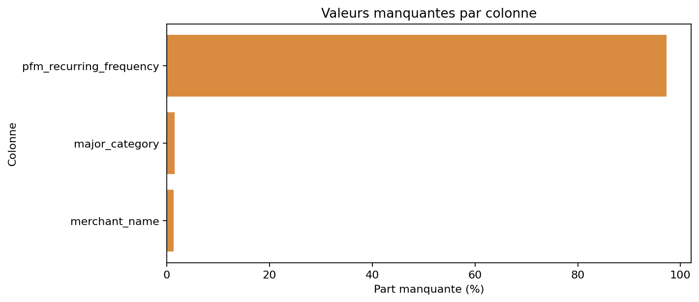
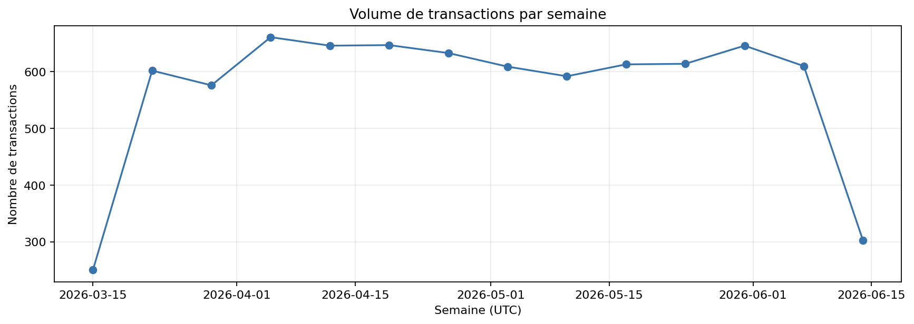
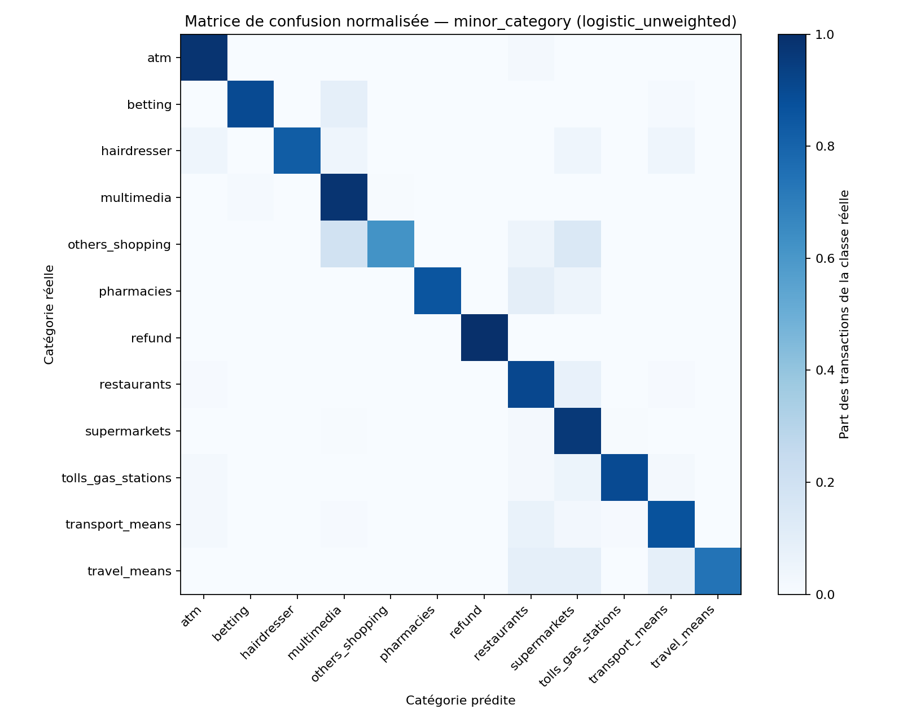

# Catégorisation de transactions Lydia

## Résumé

Ce projet répond au test de catégorisation PFM : à partir des informations disponibles lors de la création d’une transaction, prédire ses catégories `minor_category` et `major_category`, puis exposer le résultat dans une API locale.

Le CSV fourni est synthétique. Après déduplication stricte, il contient 8 001 transactions. Le modèle retenu est une régression logistique entraînée sur `minor_category` ; `major_category` est déduite d’une correspondance apprise sur le train. Sur le test temporel final, le macro-F1 est de **0,905** pour la catégorie fine et de **0,894** pour la catégorie principale parmi les lignes annotées. Ces scores décrivent uniquement ce fichier et ne garantissent pas la performance sur des transactions réelles.

## 1. Cibles et contrat de sortie

L’API renvoie les deux catégories. Dans le CSV, chaque catégorie fine autre que `refund` correspond à une seule catégorie principale. Certaines catégories principales regroupent plusieurs catégories fines : la correspondance ne peut donc être appliquée que dans le sens `minor_category` → `major_category`.

| `minor_category` | `major_category` |
|---|---|
| `supermarkets` | `groceries` |
| `multimedia` | `entertainment` |
| `restaurants` | `restaurants_bars_cafes` |
| `betting` | `entertainment` |
| `tolls_gas_stations` | `transportation` |
| `atm` | `finance` |
| `refund` | `null` dans les annotations fournies |
| `hairdresser` | `self_care` |
| `others_shopping` | `shopping` |
| `pharmacies` | `self_care` |
| `transport_means` | `transportation` |
| `travel_means` | `travel` |

J’entraîne donc un modèle sur `minor_category`, puis j’applique la correspondance apprise sur le train. Pour `refund`, `major_category` reste à `null`, comme dans les annotations. Cette règle est propre au CSV et devra être confirmée par le propriétaire de la taxonomie avant un usage métier.


En l’absence de référentiel métier indépendant, les catégories du CSV servent de référence pour l’évaluation. L’exploration a toutefois révélé des libellés associés à plusieurs catégories ; les scores doivent être lus avec cette limite en tête.

## 2. Données et exploration

Le CSV brut contient 8 121 lignes et 19 colonnes. J’ai examiné les cibles, les valeurs manquantes, les montants, les dates, les répétitions, les cardinalités et les liens entre champs avant l’entraînement.

| Constat | Résultat | Décision |
|---|---:|---|
| Transactions après déduplication | 8 001, du 13 mars au 10 juin 2026 (UTC) | Découpage temporel, décrit plus bas. |
| Cibles | 12 catégories fines, 8 principales | L’API renvoie les deux niveaux. |
| `major_category` manquante | 123 `refund` dans le brut, 120 après déduplication | Garder `refund` et renvoyer `null` pour la catégorie principale. |
| `merchant_name` manquant | 110 lignes ; `title` est complet et reprend le nom quand il existe | Utiliser `title` comme texte d’entrée. |
| `pfm_recurring_frequency` manquante | 7 781 lignes (97,25 %) ; seule valeur observée : `monthly` | Écarter ce champ : il est presque toujours vide et sa disponibilité au moment de la prédiction n’est pas établie. |
| Montants | Médiane −10,65 ; P1 −5 872,03 ; P99 5,42 ; min. −399 180,56 ; max. 76 098,48 | Conserver les valeurs et appliquer une transformation logarithmique signée. |
| Frais | 99e percentile à 0 ; maximum de 4 000 centimes | Garder le champ, malgré sa faible variation dans ce jeu. |

### Répétitions et qualité des données

J’ai trouvé 120 paires (240 lignes) partageant le même `ref_id`. Dans chaque paire, toutes les colonnes sauf `transaction_id` sont identiques et les annotations concordent. Une ligne de chaque paire est retirée **avant le découpage**, pour éviter qu’une même transaction apparaisse dans le train et le test. Le fichier ne permet pas d’établir l’origine de ces répétitions. Le script s’arrête si un `ref_id` répété présente un contenu différent.

Les classes sont déséquilibrées : `supermarkets` représente 29,3 % du jeu préparé, contre 1,5 % pour `hairdresser` — environ 20 fois moins d’exemples.

| `minor_category` | Transactions | Part |
|---|---:|---:|
| `supermarkets` | 2 341 | 29,26 % |
| `multimedia` | 1 538 | 19,22 % |
| `restaurants` | 1 260 | 15,75 % |
| `transport_means` | 847 | 10,59 % |
| `betting` | 498 | 6,22 % |
| `tolls_gas_stations` | 432 | 5,40 % |
| `atm` | 351 | 4,39 % |
| `others_shopping` | 193 | 2,41 % |
| `travel_means` | 175 | 2,19 % |
| `pharmacies` | 128 | 1,60 % |
| `refund` | 120 | 1,50 % |
| `hairdresser` | 118 | 1,47 % |


Les valeurs manquantes concernent aussi `major_category` et `merchant_name`. Les montants sont très asymétriques ; faute de contexte métier, je n’ai supprimé ni corrigé aucune valeur extrême.




`status` est exclu : dans ce fichier, `status = refunded` correspond exactement à `refund`. Le signe positif du montant distingue lui aussi parfaitement les remboursements, mais `amount_value` est conservé car il est disponible au moment de la transaction selon le sujet. Ce raccourci propre au jeu synthétique limite l’interprétation du score de `refund`.


J’ai regardé le volume par semaine pour repérer d’éventuelles ruptures ; trois mois de données synthétiques ne suffisent pas pour conclure à une saisonnalité.



Les identifiants (`transaction_id`, `ref_id`, `member_id`, `member_name`, `merchant_id`) sont exclus pour éviter la mémorisation et évaluer la généralisation à des valeurs inédites. `amount_currency` et `card_type` sont constants. `title` remplace `merchant_name`, puisqu’il est toujours renseigné.

## 3. Variables et modèles

Le prétraitement et le modèle final sont réunis dans un pipeline scikit-learn. À chaque fold, les transformations sont apprises uniquement sur les données d’entraînement de ce fold.

| Champ | Traitement |
|---|---|
| `title` | TF-IDF de mots, unigrammes et bigrammes ; accents normalisés, `min_df=2`, 20 000 termes maximum. |
| `amount_value` | `sign(x) × log(1 + abs(x))`, puis standardisation. |
| `fees` | `log(1 + fees)`, puis standardisation ; les frais sont en centimes. |
| `created_at` | Sinus et cosinus de l’heure et du jour de semaine en UTC ; pas de date absolue. |
| `card_name`, `digitalization_type`, `merchant_pan_entry_method` | Valeurs manquantes explicites, one-hot ; modalités vues moins de 10 fois regroupées. |

Le statut, les cibles, les identifiants, les champs constants et `pfm_recurring_frequency` sont exclus.

J’ai comparé une régression logistique et XGBoost, chacun avec et sans pondération des classes. XGBoost utilise un réglage fixe (80 arbres, profondeur 4, taux d’apprentissage 0,05) ; il n’y a pas eu de recherche d’hyperparamètres.

## 4. Découpage et sélection

Après déduplication, le découpage se fait par date UTC :

| Jeu | Période | Lignes | Usage |
|---|---|---:|---|
| `train` | 13 mars au 28 mai 2026 inclus | 6 834 | Validation temporelle et entraînement final. |
| Test final | 29 mai au 10 juin 2026 inclus | 1 167 | Évaluation après la sélection du modèle. |

La comparaison se fait uniquement sur `train`, avec sept fenêtres temporelles successives de sept jours au plus et un historique initial d’au moins 28 jours. Les mêmes fenêtres sont utilisées pour toutes les configurations ; le test final ne sert pas à choisir ni régler le modèle.

Le critère de sélection est le **macro-F1 de `minor_category`**, qui donne le même poids à chaque classe malgré le déséquilibre. La balanced accuracy, le F1 pondéré, l’accuracy et les résultats par classe complètent l’analyse.

| Configuration | Macro-F1 moyen ± écart-type | Balanced accuracy moyenne ± écart-type |
|---|---:|---:|
| Régression logistique sans pondération | **0,866 ± 0,031** | 0,830 ± 0,034 |
| Régression logistique avec poids équilibrés | 0,850 ± 0,037 | **0,867 ± 0,026** |
| XGBoost avec poids équilibrés | 0,847 ± 0,029 | 0,851 ± 0,021 |
| XGBoost sans pondération | 0,815 ± 0,030 | 0,770 ± 0,029 |

La régression logistique sans pondération est retenue selon le macro-F1. La pondération améliore la balanced accuracy, mais réduit le critère de sélection. Les folds étant successifs et leurs historiques se recouvrant, leur écart-type décrit la variabilité observée ; ce n’est pas un intervalle de confiance.

La baseline est une seule règle apprise sur `train` : prédire `supermarkets` à chaque fois. Pour évaluer `major_category`, cette même prédiction devient `groceries` par la correspondance des catégories.

## 5. Résultats sur le test final

| Cible | Modèle | Lignes | Macro-F1 | Balanced accuracy | F1 pondéré | Accuracy |
|---|---|---:|---:|---:|---:|---:|
| `minor_category` | Baseline majoritaire | 1 167 | 0,038 | 0,083 | 0,138 | 0,299 |
| `minor_category` | Régression logistique retenue | 1 167 | **0,905** | **0,878** | **0,926** | **0,927** |
| `major_category` | Même baseline, catégorie dérivée | 1 146 | 0,058 | 0,125 | 0,142 | 0,305 |
| `major_category` | Catégorie dérivée du modèle | 1 146 | **0,894** | **0,867** | **0,934** | **0,935** |

Le modèle prédit `minor_category`, puis applique la correspondance apprise sur le train pour obtenir `major_category`. Les 21 remboursements du test sans catégorie principale sont exclus du score de `major_category`. Le modèle prédit correctement les 21 `refund` en catégorie fine, mais le lien parfait avec le montant positif dans ce jeu empêche d’en déduire une performance robuste sur des données réelles.

Dans le test, 1 103 transactions sur 1 167 (94,5 %) ont un titre déjà vu dans le train. Les résultats par cohorte montrent l’écart entre libellés connus et inédits ; les petits groupes doivent être interprétés avec prudence.

| Cohorte | Lignes | Classes présentes | Macro-F1 | Accuracy |
|---|---:|---:|---:|---:|
| `title` connu dans le train | 1 103 | 12 | 0,914 | 0,939 |
| `title` inédit | 64 | 10 | 0,577 | 0,719 |
| `merchant_id` connu dans le train | 883 | 12 | 0,928 | 0,958 |
| `merchant_id` inédit | 284 | 12 | 0,809 | 0,831 |

Le sous-groupe `merchant_id` inédit peut contenir des titres déjà vus ; le modèle utilise le texte, pas cet identifiant.



| Catégorie réelle | Support test | Précision | Rappel | F1 |
|---|---:|---:|---:|---:|
| `atm` | 58 | 0,891 | 0,983 | 0,934 |
| `betting` | 67 | 0,952 | 0,896 | 0,923 |
| `hairdresser` | 23 | 1,000 | 0,826 | 0,905 |
| `multimedia` | 217 | 0,938 | 0,982 | 0,959 |
| `others_shopping` | 21 | 0,867 | 0,619 | 0,722 |
| `pharmacies` | 21 | 0,947 | 0,857 | 0,900 |
| `refund` | 21 | 1,000 | 1,000 | 1,000 |
| `restaurants` | 193 | 0,893 | 0,907 | 0,900 |
| `supermarkets` | 349 | 0,926 | 0,963 | 0,944 |
| `tolls_gas_stations` | 59 | 0,946 | 0,898 | 0,922 |
| `transport_means` | 115 | 0,935 | 0,870 | 0,901 |
| `travel_means` | 23 | 1,000 | 0,739 | 0,850 |

Le modèle diffère des annotations du CSV sur 85 transactions (7,3 %). Les écarts les plus fréquents sont `restaurants` vers `supermarkets` (14 cas), `transport_means` vers `restaurants` (8), `betting` vers `multimedia` (6) et `supermarkets` vers `restaurants` (6).

L’audit a retrouvé ces 85 écarts dans le CSV brut. Certains titres reçoivent plusieurs catégories : `APPLE.COM/BILL`, par exemple, est principalement annoté `multimedia`, mais apparaît aussi en `betting`, `others_shopping` et `refund`. Un montant de −330 978,29 € est associé à `Burger King` et annoté `supermarkets`. Sans référentiel métier, ces cas ne suffisent pas à conclure que les annotations ou montants sont erronés ; aucune correction n’a été appliquée.

## 6. Reproduire l’analyse et l’entraînement

Depuis la racine du dépôt, avec Python 3.13 :

```bash
python -m venv .venv
```

Sous Windows PowerShell :

```powershell
.venv\Scripts\Activate.ps1
```

Sous macOS ou Linux :

```bash
source .venv/bin/activate
```

Puis installer les dépendances et lancer les étapes dans l’ordre :

```bash
pip install -r requirements.txt
python -m src.transaction_labeling.eda
python -m src.transaction_labeling.prepare_data
python -m src.transaction_labeling.compare_models
python -m src.transaction_labeling.train
python -m src.transaction_labeling.evaluate
python -m src.transaction_labeling.analyze_test_errors
python -m src.transaction_labeling.audit_test_error_cases
python -m unittest discover -s tests
```

- `eda` décrit les données et génère les graphiques et tableaux.
- `prepare_data` déduplique, vérifie le schéma et crée les jeux `train` et test. Les garde-fous sont calibrés sur le CSV fourni.
- `compare_models` évalue quatre configurations sur les mêmes fenêtres temporelles.
- `train` sélectionne celle au meilleur macro-F1 moyen et l’entraîne sur tout `train`.
- `evaluate` calcule les résultats sur le test ; les deux scripts suivants analysent puis vérifient les erreurs dans la source.
- `unittest` couvre les règles de données, la sélection, le schéma et les routes de l’API.

Le test final a déjà été analysé. Il ne doit pas servir à régler une nouvelle version du modèle ; une nouvelle sélection doit être confirmée sur un test indépendant.

## 7. API locale

Après l’entraînement, démarrer l’API depuis la racine du dépôt :

```bash
uvicorn src.transaction_labeling.api:app --host 127.0.0.1 --port 8000
```

- `GET /health` confirme que l’API répond et indique le modèle chargé.
- `POST /predict` reçoit une transaction et renvoie `minor_category` et `major_category`.
- `title`, `amount_value` et `created_at` sont requis. La date doit être ISO 8601 avec fuseau horaire ; UTC est recommandé.
- `fees` est facultatif (0 par défaut, en centimes). Les champs `card_name`, `digitalization_type` et `merchant_pan_entry_method` sont facultatifs et acceptent `null`.
- Les champs inconnus sont refusés. Une entrée invalide renvoie HTTP 422 ; une erreur interne d’inférence renvoie HTTP 500.
- Pour `refund`, `major_category` vaut `null`.

Exemple :

```bash
curl -X POST http://127.0.0.1:8000/predict \
  -H "Content-Type: application/json" \
  -d '{"title":"CARREFOUR MARKET","amount_value":-24.5,"created_at":"2026-06-11T12:30:00Z","fees":0,"card_name":"Carte Lydia bleue","digitalization_type":"apple_pay","merchant_pan_entry_method":"CHIP_CONTACTLESS"}'
```

Réponse :

```json
{
  "minor_category": "supermarkets",
  "major_category": "groceries"
}
```

Les catégories illustrent le format de réponse ; elles ne sont pas garanties pour cet exemple. La documentation interactive est disponible sur `http://127.0.0.1:8000/docs`.

## 8. Docker

Le [Dockerfile](Dockerfile) installe les dépendances, copie le code et le modèle, puis lance Uvicorn sur le port 8000. L’entraînement doit avoir été exécuté avant la construction de l’image.

```bash
docker build -t lydia-transaction-labeling .
docker run --rm -p 8000:8000 lydia-transaction-labeling
```

## 9. Limites et prochaines étapes

Les résultats restent indicatifs : le CSV est synthétique et court, 94,5 % des titres du test sont déjà vus à l’entraînement, et le signe du montant distingue parfaitement `refund` dans ce fichier. Avant un usage métier, je prioriserais :

1. **Construire une référence fiable.** Faire arbitrer par Produit ou Opérations un échantillon des libellés associés à plusieurs catégories et des principales confusions. Constituer ensuite un jeu de test annoté et vérifié indépendamment ; les 85 écarts actuels sont des désaccords avec le CSV, pas nécessairement 85 erreurs métier.
2. **Mesurer la généralisation aux libellés nouveaux.** Le test ne contient que 64 titres inédits, avec un macro-F1 de 0,577, contre 0,914 pour les titres connus. Collecter plusieurs périodes futures avec assez d’exemples par classe et publier les résultats par cohorte. Sur ce jeu indépendant, comparer le TF-IDF actuel à des n-grammes de caractères, adaptés aux variantes de libellés de paiement ; garder le test actuel à l’écart du réglage.
3. **Choisir l’objectif selon le coût métier.** Le macro-F1 donne le même poids à chaque classe ; il convient à cette comparaison, mais ne décrit pas à lui seul l’impact produit. Avec les équipes métier, quantifier les erreurs coûteuses, calibrer les probabilités sur la validation temporelle, puis mesurer le compromis entre couverture automatique et risque d’erreur avant de fixer une politique de revue.
4. **Tester un LLM comme solution de repli ciblée.** Après calibration, router vers un LLM les libellés inédits ou les prédictions peu sûres, avec catégories autorisées, format structuré et possibilité de demander une revue humaine. Comparer classifieur seul, LLM et dispositif avec repli sur un nouveau jeu annoté. Mesurer les erreurs évitées, la couverture, la latence et le coût ; n’envoyer que les informations nécessaires, sans identifiants, avec inférence hébergée en Europe. Ne retenir cette option que si le gain mesuré justifie son coût et sa complexité.
5. **Valider le signal de remboursement et l’exploitation.** Confirmer que le signe de `amount_value` est disponible et fiable au moment réel de la prédiction ; les 21 remboursements du test ne suffisent pas à prouver sa robustesse. Avant déploiement, exécuter le conteneur et la CI, puis suivre les erreurs d’API, les champs inconnus, la latence et les performances par classe quand les annotations arrivent.

XGBoost n’a pas dépassé la régression logistique dans les configurations testées. Cette comparaison ne permet pas de conclure qu’il ne pourrait jamais faire mieux : une nouvelle recherche de paramètres demanderait davantage de données de validation et un test final indépendant.

## 10. Organisation du dépôt

- `data/raw/` : CSV source fourni.
- `data/processed/` : jeux préparés et résumé du découpage.
- `reports/figures/` : graphiques affichés dans ce README.
- `src/transaction_labeling/` : EDA, préparation, validation, entraînement, évaluation, analyses et API.
- `models/` : artefact entraîné et manifeste.
- `tests/` : tests des règles de données, du modèle, du schéma et des routes HTTP.

Les rapports détaillés, tableaux et documents de travail restent locaux et sont ignorés par Git. Seules les images utilisées dans ce README sont versionnées.
