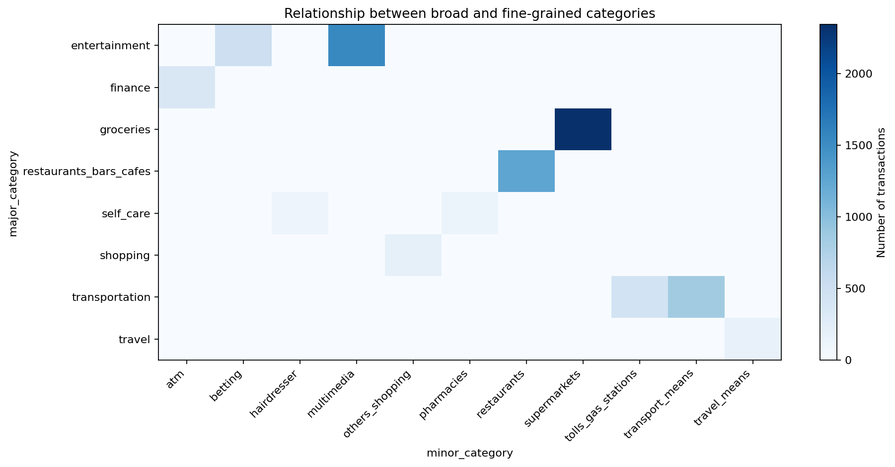
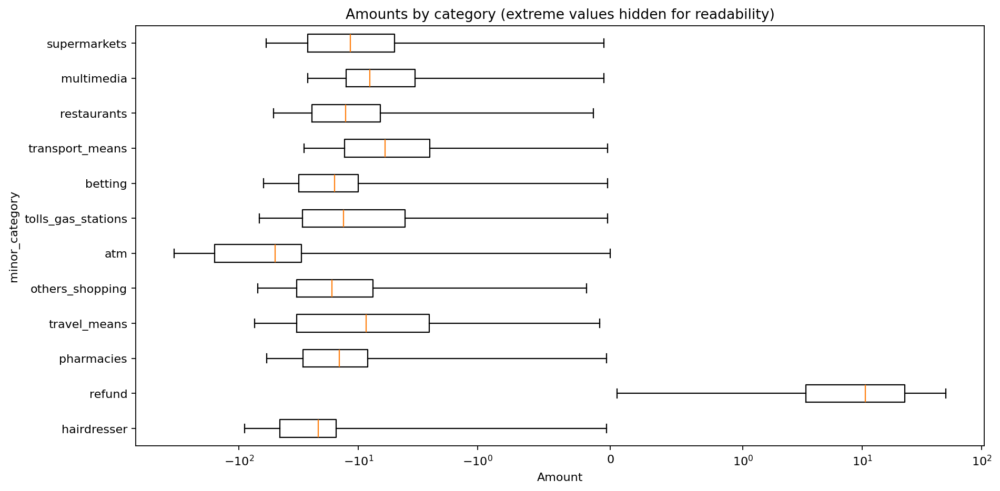
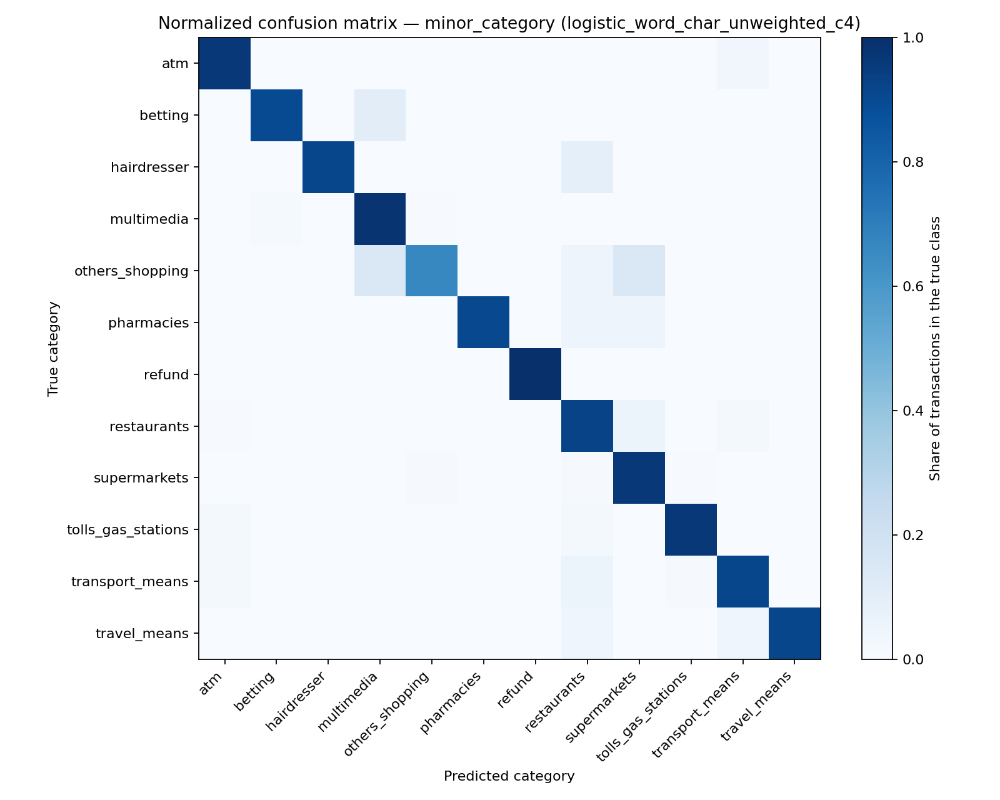

# Lydia Transaction Labeling

## Summary

This project addresses the PFM transaction-labeling test: given the information available when a transaction is created, predict its `minor_category` and `major_category`, then return both through a local API.

The supplied CSV is synthetic. After deduplication, it contains 8,001 transactions. Temporal cross-validation selected logistic regression with word and character TF-IDF features (`C=4`), trained on `minor_category`; `major_category` is derived from a mapping learned on the training data. The model's mean validation macro-F1 is **0.903**. I had already inspected the test set during exploratory analysis, so its results are descriptive rather than an independent estimate of performance.

## 1. Targets and output contract

The API returns both categories. In this CSV, every `minor_category` other than `refund` maps to exactly one `major_category` (for example, `betting` and `multimedia` both map to `entertainment`). I train the model on the fine-grained category, then derive the broader category from a mapping learned on the training data. For `refund`, `major_category` remains `null`, as it does in the annotations. The taxonomy owner should confirm this rule before any business use.



There is no independent business taxonomy to validate the CSV labels against, so I use the CSV annotations as the evaluation reference. The exploration did uncover titles associated with more than one category, which is an important limitation when interpreting the scores.

## 2. Data and exploration

The raw CSV has 8,121 rows and 19 columns. Before training, I examined the targets, missing values, amounts, dates, repeated rows, cardinalities, and relationships between fields.

| Finding | Result | Decision |
|---|---:|---|
| Transactions after deduplication | 8,001, from March 13 to June 10, 2026 (UTC) | Use a temporal split, described below. |
| Targets | 12 fine-grained categories, 8 broad categories | Return both levels from the API. |
| Missing `major_category` | 123 `refund` rows in the raw data; 120 after deduplication | Keep `refund` and return `null` for its broad category. |
| Missing `merchant_name` | 110 rows; `title` is complete and contains the merchant name when available | Use `title` as the text input. |
| Missing `pfm_recurring_frequency` | 7,781 rows (97.25%); the only observed value is `monthly` | Drop it: it is almost always missing, and its availability at prediction time is unclear. |
| Amounts | Median −10.65; P1 −5,872.03; P99 5.42; min. −399,180.56; max. 76,098.48 | Keep the values and apply a signed logarithmic transform. |
| Fees | 99th percentile is 0; maximum is 4,000 cents | Keep the field, despite its limited variation in this dataset. |

### Repeated rows and data quality

I found 120 pairs (240 rows) with the same `ref_id`. Within each pair, every column except `transaction_id` is identical, and the labels agree. I remove one row from each pair **before splitting** so the same transaction cannot appear in both train and test. The CSV does not reveal why these rows were repeated. The script stops if a repeated `ref_id` has conflicting content.

The classes are imbalanced: `supermarkets` accounts for 29.3% of rows, compared with 1.5% for `hairdresser`.


There are also missing values in `major_category` and `merchant_name`. Amounts are highly skewed; without business context, I have not removed or changed any extreme values.

Among non-`refund` transactions, 273 of 6,533 (4.2%) have a label that differs from the most common label for their title, considering titles that appear at least five times. The lowest such purity is 71.4% (`AREA NFC`). These are disagreements with the title's historical mode, not proven annotation errors.




I exclude `status`: in this file, `status = refunded` matches `refund` exactly. Positive amounts also identify every refund in this CSV, but I keep `amount_value` because it is available when a transaction is created according to the test brief. This shortcut in the synthetic data limits what the `refund` score tells us about production performance.


I also checked transaction volume by week for possible breaks in the data. Three months of synthetic data are not enough to draw conclusions about seasonality.

I exclude identifiers (`transaction_id`, `ref_id`, `member_id`, `member_name`, `merchant_id`) to avoid memorization and test generalization to unseen values. `amount_currency` and `card_type` are constant. I use `title` instead of `merchant_name` because `title` is always populated.

## 3. Features and models

The preprocessing and final model are combined in a scikit-learn pipeline. Within each fold, transformations are fitted only on that fold's training data.

| Field | Treatment |
|---|---|
| `title` | Word TF-IDF (1–2 grams) and character TF-IDF (`char_wb`, 2–5 grams), fitted in each fold. Vocabulary is capped at 20,000 word and 50,000 character n-grams. |
| `amount_value` | `sign(x) × log(1 + abs(x))`, then standardized. |
| `fees` | `log(1 + fees)`, then standardized; fees are in cents. |
| `created_at` | Sine and cosine of the UTC hour and day of the week; no absolute date. |
| `card_name`, `digitalization_type`, `merchant_pan_entry_method` | Explicit missing-value categories and one-hot encoding; values seen fewer than 10 times are grouped. |

I exclude `status`, target fields, identifiers, constant fields, and `pfm_recurring_frequency`.

The comparison covers ten configurations: logistic regression with word-only or word-and-character TF-IDF, with or without class weighting, and `C` values of 1, 4, or 10 for the richer text variants; XGBoost is tested with and without class weighting, using fixed settings (80 trees, depth 4, learning rate 0.05).

## 4. Temporal split and model selection

After deduplication, I split the data by UTC date:

| Set | Period | Rows | Use |
|---|---|---:|---|
| `train` | March 13 through May 28, 2026 | 6,834 | Temporal cross-validation and final model training. |
| Temporal test set, already inspected | May 29 through June 10, 2026 | 1,167 | Descriptive evaluation; results are not independent. |

Model comparison uses seven successive temporal validation windows, each up to seven days long, with at least 28 days of history to train on. All ten configurations and the baseline use the same windows; transformations are refitted on each fold's training history.

I select models by **macro-F1 for `minor_category`**, which gives each class equal weight despite the imbalance. Balanced accuracy, weighted F1, accuracy, and per-class results provide additional context.

| Selected configuration | Mean macro-F1 ± standard deviation | Mean balanced accuracy ± standard deviation |
|---|---:|---:|
| Title-history baseline | 0.865 ± 0.019 | 0.822 ± 0.022 |
| Logistic regression, word TF-IDF, `C=1` | 0.866 ± 0.031 | 0.830 ± 0.034 |
| Logistic regression, word + character TF-IDF, `C=1` | 0.898 ± 0.021 | 0.871 ± 0.027 |
| Logistic regression, word + character TF-IDF, `C=4` | **0.903 ± 0.023** | 0.882 ± 0.027 |
| Logistic regression, word + character TF-IDF, `C=10` | 0.900 ± 0.023 | 0.882 ± 0.025 |
| Weighted XGBoost | 0.847 ± 0.029 | 0.851 ± 0.021 |

I select the word-and-character model with `C=4` by macro-F1. Class weighting improves balanced accuracy but lowers macro-F1. I did not resample the data: duplicating rare transactions would not add new examples, and removing frequent transactions would discard useful variety. The validation windows and test set retain the observed class distribution.

The baseline predicts the most common non-refund category for a normalized title in the fold's history, falling back to the overall majority class. It predicts `refund` from the amount sign only when that rule is perfect in the fold's training data. I use it as a reference, not as the selected ML pipeline. Standard deviations describe the seven observed windows; they are not confidence intervals.

## 5. Results on the test set already inspected

I selected the model using temporal cross-validation on `train`. However, I had previously used the test set for error analysis and exploratory experiments. These results are therefore descriptive, not an independent estimate of performance.

| Target | Reference | Rows | Macro-F1 | Balanced accuracy | Weighted F1 | Accuracy |
|---|---|---:|---:|---:|---:|---:|
| `minor_category` | Title-history baseline | 1,167 | 0.897 | 0.869 | 0.922 | 0.924 |
| `minor_category` | Logistic regression, word + character TF-IDF, `C=4` | 1,167 | **0.928** | **0.918** | **0.945** | **0.945** |
| `major_category` | Derived title-history baseline | 1,146 | 0.901 | 0.871 | 0.929 | 0.929 |
| `major_category` | Category derived from the model | 1,146 | **0.920** | **0.910** | **0.953** | **0.954** |

The 21 `refund` rows without a `major_category` are excluded from the broad-category score. The model correctly predicts `refund` for all 21 test refunds, but positive amounts identify them perfectly in this synthetic CSV; this does not demonstrate production robustness.

For 1,103 test transactions (94.5%), the exact `title` value also appears in the training data. The other 64 transactions have no exact title match. These 64 rows do not necessarily represent 64 new merchants: a difference in capitalization or spacing is enough to count a title as absent under this comparison. Macro-F1 is 0.933 for transactions whose title appears in train by this exact match and 0.643 for the others; the latter score is based on a small sample. For transactions whose `merchant_id` is absent from train, macro-F1 is 0.890, although some of those transactions have a title already seen in train.



The model disagrees with the annotations on 64 transactions (5.5%). The most frequent confusions are `restaurants` → `supermarkets` (10), `betting` → `multimedia` (7), and `transport_means` → `restaurants` (7). `others_shopping` is the least well recognized class (F1 0.700 on 21 rows).

Of the 64 disagreements, 39 have a label that differs from the most common label for that title in the training data, 14 have no non-refund title history, and 11 match that historical mode. These groups help describe the errors, but do not prove annotation noise or explain the business cause. For example, `APPLE.COM/BILL` appears under several categories. The −330,978.29 € amount associated with `Burger King` is in the raw CSV, but I cannot verify whether it is valid from the available information.

## 6. Reproducing the analysis and training

From the repository root, using Python 3.13:

```bash
python -m venv .venv
```

On Windows PowerShell:

```powershell
.venv\Scripts\Activate.ps1
```

On macOS or Linux:

```bash
source .venv/bin/activate
```

Then install dependencies and run the steps in order:

```bash
pip install -r requirements.txt
python -m src.transaction_labeling.eda
python -m src.transaction_labeling.prepare_data
python -m src.transaction_labeling.compare_models
python -m src.transaction_labeling.train
python -m src.transaction_labeling.evaluate
python -m src.transaction_labeling.analyze_test_errors
python -m src.transaction_labeling.audit_test_error_cases
python -m unittest discover -s tests
```

- `eda` summarizes the data and generates charts and tables.
- `prepare_data` deduplicates the data, checks the schema, and creates the `train` and test sets. Its guardrails are calibrated to the supplied CSV.
- `compare_models` evaluates ten configurations and the title-history baseline on the same temporal windows.
- `train` selects the configuration with the best mean macro-F1 and refits it on all of `train`.
- `evaluate` scores the model on the test set; the next two scripts analyze and verify errors against the source data.
- `unittest` covers data rules, model selection, the API schema, and API routes.

The test set has already been used for error analysis and exploratory experiments. The current model is selected by temporal cross-validation on `train`, but an independent estimate will require a newly labeled period.

## 7. Local API

After training, start the API from the repository root:

```bash
uvicorn src.transaction_labeling.api:app --host 127.0.0.1 --port 8000
```

- `GET /health` confirms that the API is responding and reports the loaded model.
- `POST /predict` accepts one transaction and returns `minor_category` and `major_category`.
- `title`, `amount_value`, and `created_at` are required. The date must be ISO 8601 with a time zone; UTC is recommended.
- `fees` is optional (defaults to 0, in cents). `card_name`, `digitalization_type`, and `merchant_pan_entry_method` are optional and may be `null`.
- Unknown fields are rejected. Invalid input returns HTTP 422; an internal inference error returns HTTP 500.
- For `refund`, `major_category` is `null`.

Example:

```bash
curl -X POST http://127.0.0.1:8000/predict \
  -H "Content-Type: application/json" \
  -d '{"title":"CARREFOUR MARKET","amount_value":-24.5,"created_at":"2026-06-11T12:30:00Z","fees":0,"card_name":"Lydia Blue Card","digitalization_type":"apple_pay","merchant_pan_entry_method":"CHIP_CONTACTLESS"}'
```

Response:

```json
{
  "minor_category": "supermarkets",
  "major_category": "groceries"
}
```

The categories illustrate the response format; they are not guaranteed for this example. Interactive API docs are available at `http://127.0.0.1:8000/docs`.

## 8. Docker

The [Dockerfile](Dockerfile) installs dependencies, copies the code and model, and starts Uvicorn on port 8000. Training must be complete before building the image.

```bash
docker build -t lydia-transaction-labeling .
docker run --rm -p 8000:8000 lydia-transaction-labeling
```

## 9. Limitations and next steps

The dataset is synthetic and short, and I have already inspected the test set. Before using this for business decisions, I would prioritize:

1. **Validate the labels and taxonomy.** Resolve cases where a title has multiple labels, then create an independent test set reviewed by Product or Operations.
2. **Measure how well the model generalizes over time.** Collect real transactions across several periods and track titles and `merchant_id` values that are present or absent from the training history. For titles, define a normalization rule (capitalization and spacing) and use it consistently across periods. The 64 transactions in the current cohort are based on exact `title` matching; they are not enough to draw firm conclusions about generalization to new titles.
3. **Decide when to automate.** Macro-F1 gives every class equal weight, but it does not tell us whether a prediction is reliable enough to automate. Before exposing probabilities, I would evaluate and, if needed, calibrate them on a newly labeled period after the training data, using calibration plots, the Brier score, and log loss. The test set already inspected must not be reused for this step. If the teams need them, the API could then return the three most likely `minor_category` values with calibrated probabilities. The backend could send transactions for manual review when the top-ranked category's probability falls below a threshold set with the business teams, based on the cost of errors and their review capacity. In production, I would deploy the evaluated model and calibrator together; the API does not return probabilities today.
4. **Evaluate an LLM as a fallback.** On an independently labeled dataset, compare the main model with an LLM whose output is restricted to the allowed categories, for transactions below the confidence threshold in the previous step. If the quality justifies the cost and latency, the backend could call the LLM for those cases before any manual review. Limit the data sent and use inference hosted in Europe.
5. **Validate production operations.** Confirm the meaning of the `amount_value` sign on real data, then verify the container and CI, and monitor API errors, latency, unknown fields, and per-class quality as new labels become available.

Across the configurations I tested, logistic regression outperformed XGBoost on macro-F1. That result applies only to the configurations evaluated.
