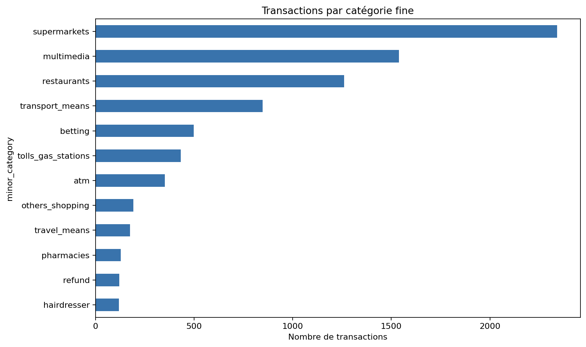
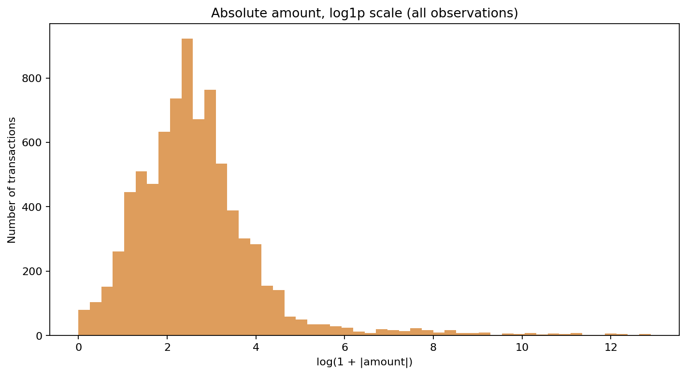
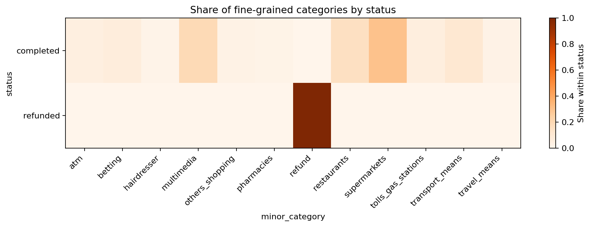

# Catégorisation de transactions Lydia

## Résumé

Ce projet répond au test de catégorisation PFM : à partir des informations disponibles lors de la création d’une transaction, prédire ses catégories `minor_category` et `major_category`, puis exposer le résultat dans une API locale.

Le CSV fourni est synthétique. Après déduplication, il contient 8 001 transactions. La validation temporelle retient une régression logistique sur TF-IDF de mots et de caractères (`C=4`), entraînée sur `minor_category` ; `major_category` est déduite d’une correspondance apprise sur le train. Son macro-F1 moyen en validation est de **0,903**. Le test avait déjà été consulté lors d’analyses exploratoires : ses résultats sont descriptifs, pas une estimation indépendante de performance.

## 1. Cibles et contrat de sortie

L’API renvoie les deux catégories. Dans le CSV, chaque `minor_category` hors `refund` correspond à une seule `major_category` (par exemple, `betting` et `multimedia` vers `entertainment`). Je prédis la catégorie fine, puis dérive la principale avec une correspondance apprise sur le train. Pour `refund`, `major_category` reste `null`, comme dans les annotations ; cette règle devra être confirmée par le propriétaire de la taxonomie avant un usage métier.


En l’absence de référentiel métier indépendant, les catégories du CSV servent de référence pour l’évaluation. L’exploration a toutefois révélé des libellés associés à plusieurs catégories ; les scores doivent être lus avec cette limite en tête.

## 2. Données et exploration

Le CSV brut contient 8 121 lignes et 19 colonnes. J’ai examiné les cibles, les valeurs manquantes, les montants, les dates, les répétitions, les cardinalités et les liens entre champs avant l’entraînement.

| Constat | Résultat | Décision |
|---|---:|---|
| Transactions après déduplication | 8 001, du 13 mars au 10 juin 2026 (UTC) | Découpage temporel, décrit plus bas. |
| Cibles | 12 catégories fines, 8 principales | L’API renvoie les deux niveaux. |
| `major_category` manquante | 123 `refund` dans le brut, 120 après déduplication | Garder `refund` et renvoyer `null` pour la catégorie principale. |
| `merchant_name` manquant | 110 lignes ; `title` est complet et reprend le nom quand il existe | Utiliser `title` comme texte d’entrée. |
| `pfm_recurring_frequency` manquante | 7 781 lignes (97,25 %) ; seule valeur observée : `monthly` | Écarter ce champ : il est presque toujours vide et sa disponibilité au moment de la prédiction n’est pas établie. |
| Montants | Médiane −10,65 ; P1 −5 872,03 ; P99 5,42 ; min. −399 180,56 ; max. 76 098,48 | Conserver les valeurs et appliquer une transformation logarithmique signée. |
| Frais | 99e percentile à 0 ; maximum de 4 000 centimes | Garder le champ, malgré sa faible variation dans ce jeu. |

### Répétitions et qualité des données

J’ai trouvé 120 paires (240 lignes) partageant le même `ref_id`. Dans chaque paire, toutes les colonnes sauf `transaction_id` sont identiques et les annotations concordent. Une ligne de chaque paire est retirée **avant le découpage**, pour éviter qu’une même transaction apparaisse dans le train et le test. Le fichier ne permet pas d’établir l’origine de ces répétitions. Le script s’arrête si un `ref_id` répété présente un contenu différent.

Les classes sont déséquilibrées : `supermarkets` représente 29,3 % des lignes, contre 1,5 % pour `hairdresser`.



Les valeurs manquantes concernent aussi `major_category` et `merchant_name`. Les montants sont très asymétriques ; faute de contexte métier, je n’ai supprimé ni corrigé aucune valeur extrême.

Parmi les transactions hors `refund`, 273 sur 6 533 (4,2 %) ont une catégorie différente de la catégorie la plus fréquente pour leur titre, lorsque celui-ci apparaît au moins cinq fois. La pureté minimale est de 71,4 % (`AREA NFC`). Ce sont des annotations divergentes de l’historique du titre, pas des erreurs métier prouvées.





`status` est exclu : dans ce fichier, `status = refunded` correspond exactement à `refund`. Le signe positif du montant distingue lui aussi parfaitement les remboursements, mais `amount_value` est conservé car il est disponible au moment de la transaction selon le sujet. Ce raccourci propre au jeu synthétique limite l’interprétation du score de `refund`.



J’ai regardé le volume par semaine pour repérer d’éventuelles ruptures ; trois mois de données synthétiques ne suffisent pas pour conclure à une saisonnalité.


Les identifiants (`transaction_id`, `ref_id`, `member_id`, `member_name`, `merchant_id`) sont exclus pour éviter la mémorisation et évaluer la généralisation à des valeurs inédites. `amount_currency` et `card_type` sont constants. `title` remplace `merchant_name`, puisqu’il est toujours renseigné.

## 3. Variables et modèles

Le prétraitement et le modèle final sont réunis dans un pipeline scikit-learn. À chaque fold, les transformations sont apprises uniquement sur les données d’entraînement de ce fold.

| Champ | Traitement |
|---|---|
| `title` | TF-IDF de mots (1–2) et de caractères (`char_wb`, 2–5), ajustés dans chaque fold. Le vocabulaire est plafonné à 20 000 mots et 50 000 n-grammes de caractères. |
| `amount_value` | `sign(x) × log(1 + abs(x))`, puis standardisation. |
| `fees` | `log(1 + fees)`, puis standardisation ; les frais sont en centimes. |
| `created_at` | Sinus et cosinus de l’heure et du jour de semaine en UTC ; pas de date absolue. |
| `card_name`, `digitalization_type`, `merchant_pan_entry_method` | Valeurs manquantes explicites, one-hot ; modalités vues moins de 10 fois regroupées. |

Le statut, les cibles, les identifiants, les champs constants et `pfm_recurring_frequency` sont exclus.

La comparaison couvre dix configurations : régression logistique avec TF-IDF mots seul ou mots+caractères, pondération équilibrée ou non et `C` égal à 1, 4 ou 10 pour les variantes texte enrichies ; XGBoost est testé avec et sans pondération, à paramètres fixes (80 arbres, profondeur 4, taux d’apprentissage 0,05).

## 4. Découpage et sélection

Après déduplication, le découpage se fait par date UTC :

| Jeu | Période | Lignes | Usage |
|---|---|---:|---|
| `train` | 13 mars au 28 mai 2026 inclus | 6 834 | Validation temporelle et entraînement final. |
| Test final | 29 mai au 10 juin 2026 inclus | 1 167 | Évaluation après la sélection du modèle. |

La comparaison se fait sur `train`, avec sept fenêtres temporelles successives de sept jours au plus et un historique initial d’au moins 28 jours. Les mêmes fenêtres sont utilisées pour les dix configurations et la baseline ; les transformations sont réajustées sur l’historique de chaque fold.

Le critère de sélection est le **macro-F1 de `minor_category`**, qui donne le même poids à chaque classe malgré le déséquilibre. La balanced accuracy, le F1 pondéré, l’accuracy et les résultats par classe complètent l’analyse.

| Configuration | Macro-F1 moyen ± écart-type | Balanced accuracy moyenne ± écart-type |
|---|---:|---:|
| Baseline historique du titre | 0,865 ± 0,019 | 0,822 ± 0,022 |
| Logistique, TF-IDF mots, `C=1` | 0,866 ± 0,031 | 0,830 ± 0,034 |
| Logistique, mots+caractères, `C=1` | 0,898 ± 0,021 | 0,871 ± 0,027 |
| Logistique, mots+caractères, `C=4` | **0,903 ± 0,023** | 0,882 ± 0,027 |
| Logistique, mots+caractères, `C=10` | 0,900 ± 0,023 | 0,882 ± 0,025 |
| XGBoost pondéré | 0,847 ± 0,029 | 0,851 ± 0,021 |

La configuration mots+caractères avec `C=4` est retenue par macro-F1. La pondération augmente la balanced accuracy, mais diminue le macro-F1. La baseline prédit la catégorie non-refund la plus fréquente du titre dans l’historique du fold, avec repli sur la classe majoritaire ; elle prédit `refund` par le signe du montant seulement si cette relation est parfaite dans le train du fold. Elle est évaluée comme référence, pas retenue comme pipeline ML. Les écart-types décrivent les sept fenêtres observées, pas des intervalles de confiance.

## 5. Résultats sur le test déjà consulté

Le choix du modèle est fait sur la validation temporelle de `train`. Le test a toutefois été consulté auparavant pour analyser les erreurs et explorer de nouvelles pistes ; ces chiffres sont donc descriptifs, pas une estimation indépendante de performance.

| Cible | Référence | Lignes | Macro-F1 | Balanced accuracy | F1 pondéré | Accuracy |
|---|---|---:|---:|---:|---:|---:|
| `minor_category` | Baseline historique du titre | 1 167 | 0,897 | 0,869 | 0,922 | 0,924 |
| `minor_category` | Logistique mots+caractères, `C=4` | 1 167 | **0,928** | **0,918** | **0,945** | **0,945** |
| `major_category` | Baseline, catégorie dérivée | 1 146 | 0,901 | 0,871 | 0,929 | 0,929 |
| `major_category` | Catégorie dérivée du modèle | 1 146 | **0,920** | **0,910** | **0,953** | **0,954** |

Les 21 `refund` sans `major_category` sont exclus du score de catégorie principale. Les 21 remboursements du test sont prédits correctement en catégorie fine, mais le signe positif du montant les distingue parfaitement dans ce CSV synthétique ; ce résultat ne démontre pas une robustesse en production.

1 103 titres du test (94,5 %) sont connus dans le train. Le macro-F1 est de 0,933 sur ces titres et de 0,643 sur les 64 titres inédits ; ce dernier score repose sur un petit échantillon. Pour les marchands inédits, le macro-F1 atteint 0,890, mais certains partagent un titre connu, que le modèle peut exploiter.


Le modèle diffère des annotations sur 64 transactions (5,5 %). Les confusions les plus fréquentes sont `restaurants` → `supermarkets` (10), `betting` → `multimedia` (7) et `transport_means` → `restaurants` (7). `others_shopping` reste la classe la moins bien reconnue (F1 0,700 sur 21 lignes).

Parmi les 64 divergences, 39 portent sur un titre dont l’annotation diffère du mode historique observé dans le train, 14 sur un titre sans historique non-refund et 11 sur un titre dont l’annotation suit cet historique. Ces groupes aident à décrire les cas, mais ne prouvent ni bruit d’annotation ni cause métier. Par exemple, `APPLE.COM/BILL` apparaît sous plusieurs catégories. Le montant de −330 978,29 € associé à `Burger King` est bien présent dans le CSV brut, mais sa validité métier n’est pas vérifiable avec les informations fournies.

## 6. Reproduire l’analyse et l’entraînement

Depuis la racine du dépôt, avec Python 3.13 :

```bash
python -m venv .venv
```

Sous Windows PowerShell :

```powershell
.venv\Scripts\Activate.ps1
```

Sous macOS ou Linux :

```bash
source .venv/bin/activate
```

Puis installer les dépendances et lancer les étapes dans l’ordre :

```bash
pip install -r requirements.txt
python -m src.transaction_labeling.eda
python -m src.transaction_labeling.prepare_data
python -m src.transaction_labeling.compare_models
python -m src.transaction_labeling.train
python -m src.transaction_labeling.evaluate
python -m src.transaction_labeling.analyze_test_errors
python -m src.transaction_labeling.audit_test_error_cases
python -m unittest discover -s tests
```

- `eda` décrit les données et génère les graphiques et tableaux.
- `prepare_data` déduplique, vérifie le schéma et crée les jeux `train` et test. Les garde-fous sont calibrés sur le CSV fourni.
- `compare_models` évalue dix configurations et la baseline historique du titre sur les mêmes fenêtres temporelles.
- `train` retient la configuration de modèle au meilleur macro-F1 moyen et la réentraîne sur tout `train`.
- `evaluate` calcule les résultats sur le test ; les deux scripts suivants analysent puis vérifient les erreurs dans la source.
- `unittest` couvre les règles de données, la sélection, le schéma et les routes de l’API.

Le test a déjà servi à des analyses d’erreurs et à des essais exploratoires. La configuration actuelle est sélectionnée par validation temporelle sur `train`, mais une estimation indépendante exigera une nouvelle période annotée.

## 7. API locale

Après l’entraînement, démarrer l’API depuis la racine du dépôt :

```bash
uvicorn src.transaction_labeling.api:app --host 127.0.0.1 --port 8000
```

- `GET /health` confirme que l’API répond et indique le modèle chargé.
- `POST /predict` reçoit une transaction et renvoie `minor_category` et `major_category`.
- `title`, `amount_value` et `created_at` sont requis. La date doit être ISO 8601 avec fuseau horaire ; UTC est recommandé.
- `fees` est facultatif (0 par défaut, en centimes). Les champs `card_name`, `digitalization_type` et `merchant_pan_entry_method` sont facultatifs et acceptent `null`.
- Les champs inconnus sont refusés. Une entrée invalide renvoie HTTP 422 ; une erreur interne d’inférence renvoie HTTP 500.
- Pour `refund`, `major_category` vaut `null`.

Exemple :

```bash
curl -X POST http://127.0.0.1:8000/predict \
  -H "Content-Type: application/json" \
  -d '{"title":"CARREFOUR MARKET","amount_value":-24.5,"created_at":"2026-06-11T12:30:00Z","fees":0,"card_name":"Carte Lydia bleue","digitalization_type":"apple_pay","merchant_pan_entry_method":"CHIP_CONTACTLESS"}'
```

Réponse :

```json
{
  "minor_category": "supermarkets",
  "major_category": "groceries"
}
```

Les catégories illustrent le format de réponse ; elles ne sont pas garanties pour cet exemple. La documentation interactive est disponible sur `http://127.0.0.1:8000/docs`.

## 8. Docker

Le [Dockerfile](Dockerfile) installe les dépendances, copie le code et le modèle, puis lance Uvicorn sur le port 8000. L’entraînement doit avoir été exécuté avant la construction de l’image.

```bash
docker build -t lydia-transaction-labeling .
docker run --rm -p 8000:8000 lydia-transaction-labeling
```

## 9. Limites et prochaines étapes

Le jeu est synthétique et court, et le test a déjà été exploré. Avant un usage métier, je prioriserais :

1. **Valider les annotations et la taxonomie.** Faire arbitrer les libellés associés à plusieurs catégories, puis constituer un jeu de test indépendant vérifié par Produit ou Opérations.
2. **Mesurer la généralisation dans le temps.** Collecter des transactions réelles sur plusieurs périodes et suivre séparément les titres connus et nouveaux. Les 64 titres inédits actuels sont trop peu nombreux pour conclure solidement.
3. **Définir l’automatisation sûre.** Le macro-F1 traite toutes les classes à égalité. Avec les équipes métier, quantifier le coût des erreurs, calibrer les probabilités sur des données de validation et déterminer quand demander une revue humaine. L’API ne renvoie pas encore de score de confiance.
4. **Évaluer un LLM sur les cas difficiles.** Tester une sortie contrainte à la taxonomie comme solution de repli pour les titres nouveaux ou ambigus, sur un jeu annoté indépendant. Comparer qualité, couverture, latence et coût ; minimiser les données envoyées et utiliser une inférence hébergée en Europe.
5. **Valider l’exploitation.** Confirmer le sens du signe de `amount_value` sur des données réelles, puis vérifier le conteneur et la CI et suivre erreurs API, latence, champs inconnus et qualité par classe lorsque les annotations arrivent.

Dans les configurations évaluées, la régression logistique dépasse XGBoost selon le macro-F1. Ce résultat ne vaut que pour les paramètres testés.
